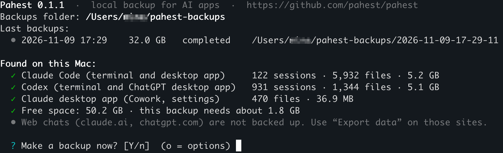
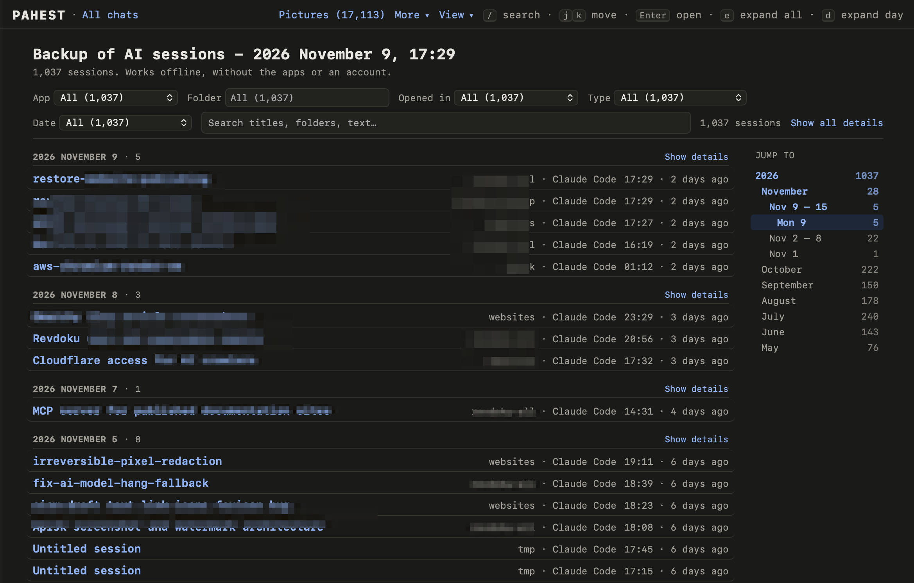
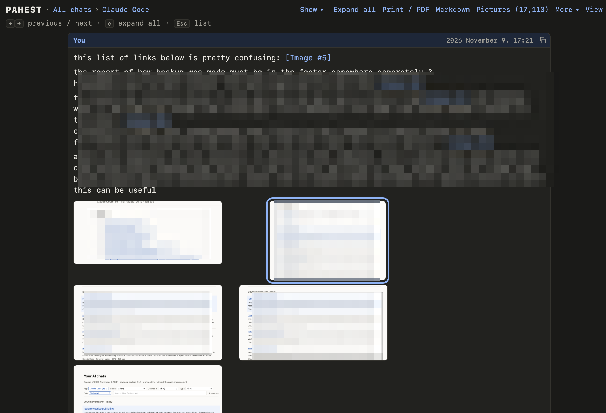
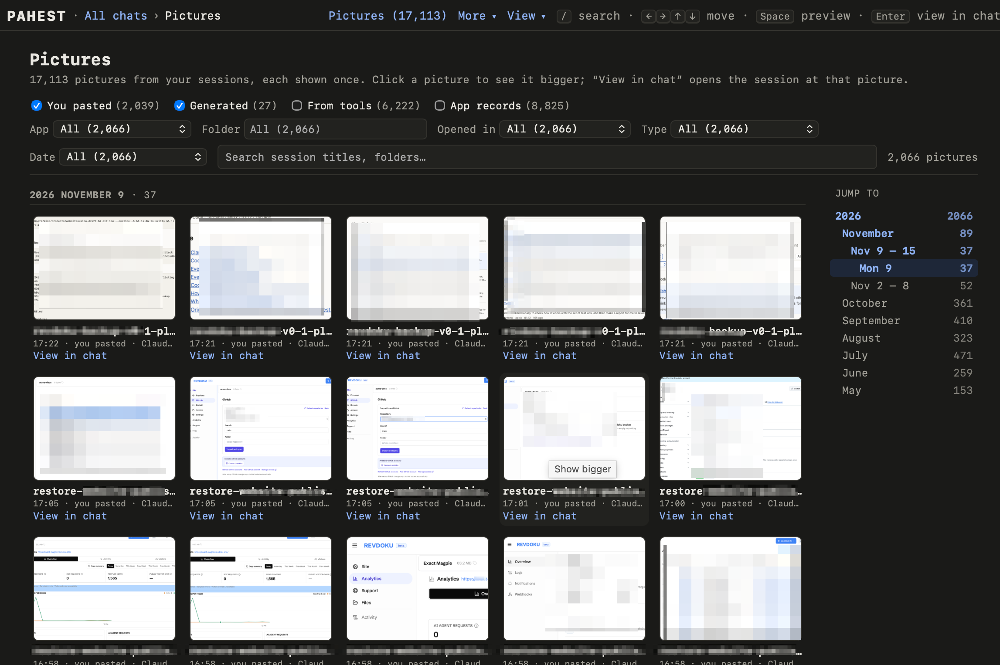
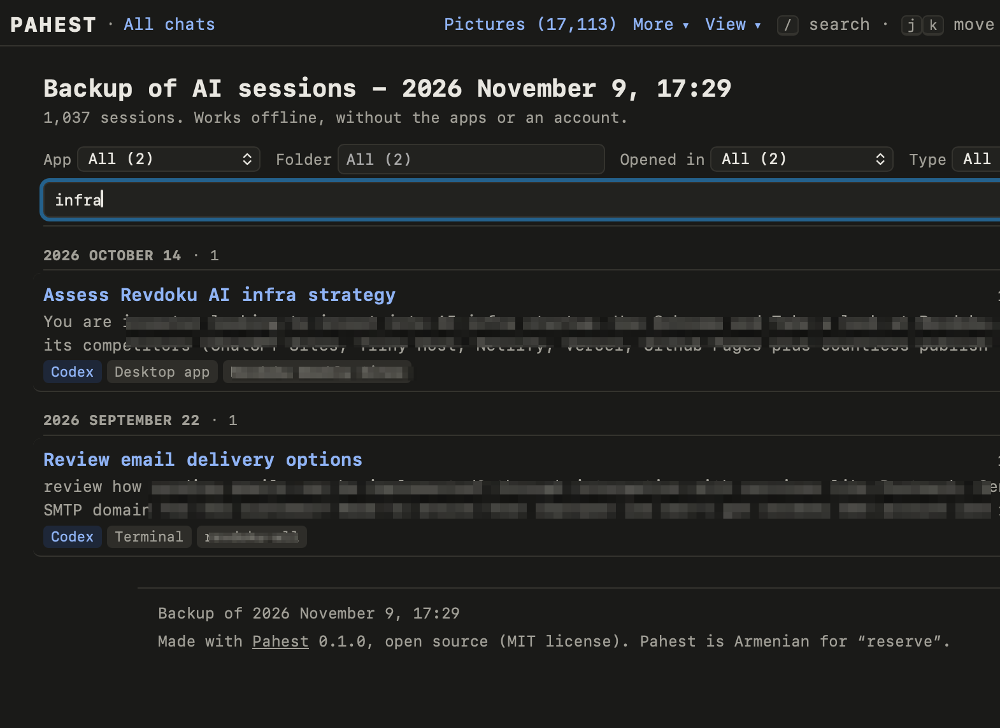
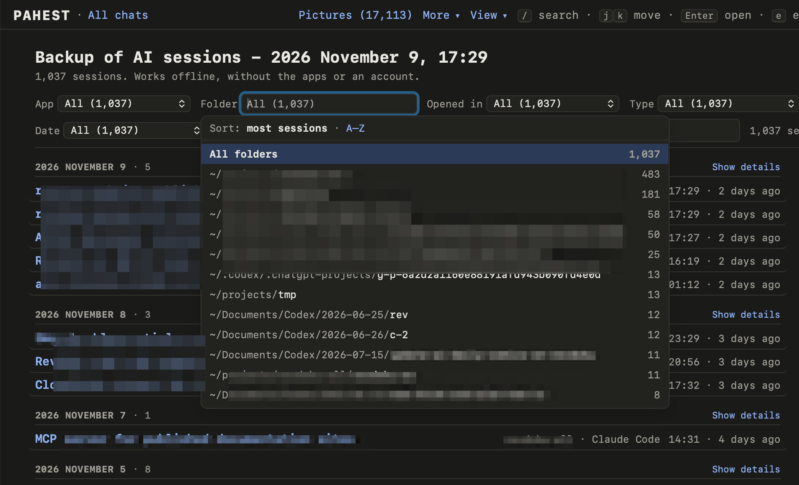
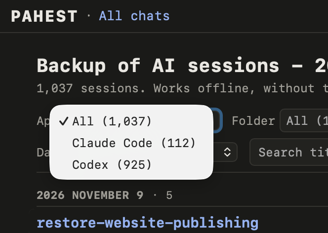
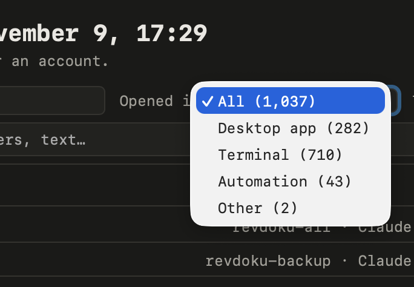
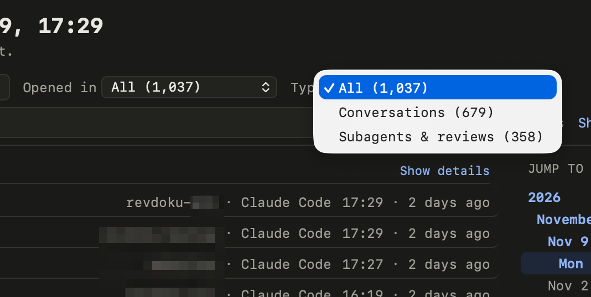

# Pahest

*Pahest* is the Armenian word **պահեստ** (say “pa-HEST”). It means “reserve”.

Pahest makes a backup of your **Claude Code** and **Codex** sessions on a Mac, and turns it into web pages you can read and search offline. If an app deletes old sessions, or you lose an account, your history is still on your disk.

What it does:

- **Copies the files as they are.** Every run makes an exact copy of the files the apps keep on your Mac, in a new folder in `~/pahest-backups`. Nothing in them is changed or shortened.
- **Adds reports you can read.** Next to the copies it makes web pages, so a person can review the backup without the apps: a list of all sessions with search and filters, and one page per session with every message.
- **Shows all pictures in one place.** A separate Pictures page shows every image from your sessions; a click opens it large, or opens the session it came from.
- **Checks itself.** After each run it reads every file back, and writes a report of what was saved and any problems.

Good to know:

- It only reads the apps' files. It never changes them and never connects to the internet.
- It needs no app and no account to read the backup: it is ordinary files.
- Free and open source (MIT license). Not made by, or connected to, Anthropic or OpenAI.

## Install and run

You need a Mac with [Homebrew](https://brew.sh). Open the **Terminal** app and paste:

```sh
brew install pahest/pahest/pahest
pahest
```

Press **Enter** to start the backup. At the end, hold **Cmd** and click the link it shows to open your chats.



*The start screen: your backups folder, the last backups, what was found on the Mac, and one question.*

- **Stop:** press **Ctrl+C** at any time. What is saved by then is kept.
- **Next backup:** run `pahest` again. Every run makes a new, complete backup.
- **Update:** `brew upgrade pahest`.
- **Without Homebrew:** `git clone https://github.com/pahest/pahest.git`, then `cd pahest` and `./pahest`.

## Screenshots

**All sessions.** One list of every session from every app, newest first, with dates to jump to at the right.



**One session.** Every message in full. Pictures are small until you click them, and `[Image #5]` in your text opens its picture.



**Pictures.** Every picture from your sessions on one page. Click one to see it large, or open the chat it came from.



**Search.** Type a few words to find sessions by title, folder or the start of the conversation.



**Filter by folder.** Type a part of a path, or choose from the list. The busiest folders come first.



**More filters.** By app, by where the session was opened, and by type (your conversations, or subagents and reviews).

  

## Limits

- **macOS only.** On Windows or Linux it stops with a message.
- **Only what is on your Mac.** Chats on claude.ai and chatgpt.com are on the companies' servers, and their terms do not allow a tool to download them. Use each app's own export: *Settings → Privacy → Export data* (Claude) and *Settings → Data controls → Export data* (ChatGPT).
- **Some reasoning cannot be read.** The apps store part of the model's private reasoning encrypted; it is kept, but nobody except the company can read it.
- **Early version (0.1).** Tested on few Macs.

## More

- [Everything in detail](docs/details.md): what is saved, the options, how the backup is checked, disk space.
- [How it is built](AGENTS.md): design rules for people and AI agents who change the code.
- [License](LICENSE): MIT.
